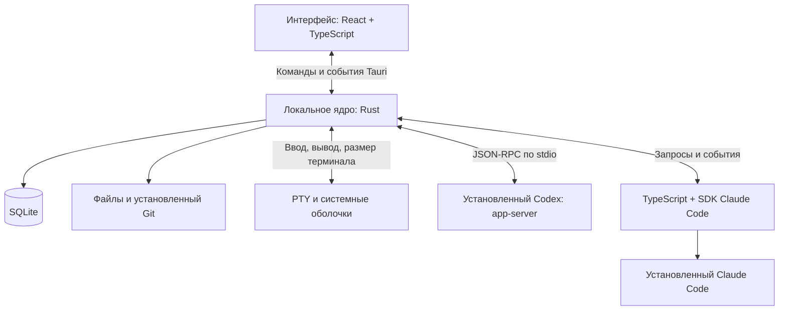

# Устройство ADE

Проект реализации на основе [согласованных требований MVP](mvp.md). Стек, компоненты редактора и терминала, вспомогательный процесс Claude, поставка со встроенной средой Node.js и использование текущего входа Codex выбраны. Неподтверждённая совместимость интеграций отмечена отдельно; [план реализации](implementation-plan.md) начинается с её проверки.

## Состав приложения

Приложение работает на компьютере пользователя. Ядро управляет окнами, состоянием и запущенными процессами; закрытие окна не завершает ядро. Полный выход через Cmd+Q завершает работу после согласованного предупреждения. Отдельная служба, переживающая полный выход, для выбранного поведения не требуется.

Интерфейс отображает данные и отправляет команды ядру. Доступ к файлам, Git, оболочкам и исполнителям проходит через локальное ядро; входящие команды проверяются относительно выбранного проекта, пространства и сессии.

## Выбранные компоненты

| Задача | Компонент | Граница ответственности |
|---|---|---|
| Редактирование текста | CodeMirror 6 | Подсветка, редактирование, поиск в открытом документе и история правок |
| Просмотр изменений | @codemirror/merge | Два текста рядом или изменения внутри одного представления |
| Отображение терминала | xterm.js и @xterm/addon-fit | Терминальный поток, пользовательский ввод и размер сетки |
| Процессы терминала | portable-pty в Rust | PTY, запуск оболочки, чтение, запись, изменение размера и завершение |
| Git | Установленный Git через отдельные процессы | Worktree, ветки, состояние, diff, индекс, коммиты и отправка |
| Локальное состояние | SQLite под управлением ядра | Проекты, пространства, сессии, история, черновики и расположение вкладок |

CodeMirror выбран по соответствию базовому составу редактора. Дерево файлов, вкладки, сохранение и поиск по проекту остаются функциями ADE. Компонент сравнения текстов не реализует Git-операции.

Источники: [CodeMirror](https://codemirror.net/docs/guide/), [сравнение текстов](https://github.com/codemirror/merge), [xterm.js](https://xtermjs.org/docs/api/terminal/classes/terminal/), [дополнения терминала](https://xtermjs.org/docs/guides/using-addons/), [portable-pty](https://docs.rs/portable-pty/latest/portable_pty/).

## Подключение исполнителей

### Codex

Установленным `codex app-server` управляет ядро на Rust через stdio. Документированный протокол передаёт события разговора, запросы разрешений, остановку и продолжение сессий. ADE хранит связь своей сессии с идентификатором разговора Codex.

MVP использует существующий штатный вход установленного Codex по подписке пользователя. ADE запрашивает состояние через интерфейс исполнителя и подсказывает, если нужен вход; собственное извлечение или копирование токенов не требуется. Работоспособность с конкретной версией и подпиской должна быть подтверждена при реализации.

Источники: [App Server](https://learn.chatgpt.com/docs/app-server), [подключение через Sign in with ChatGPT](https://developers.openai.com/siwc/token-sharing-open-source/codex-app-server).

### Claude Code

Для полноценного чата выбран вспомогательный процесс на TypeScript с официальным Claude Agent SDK, который запускает установленный пользователем неизменённый Claude Code. Такой процесс передаёт события, ответы на запросы разрешений и управление сессией между SDK и ядром ADE.

Среда Node.js и вспомогательный процесс поставляются внутри готового приложения. Их версии фиксируются при сборке; работа самой ADE не зависит от отдельно установленного Node.js. Claude Code остаётся установленным пользователем инструментом.

Вход остаётся штатным входом Claude Code. ADE не собирает его токены и не подменяет способы аутентификации. Документация описывает подписочный запуск неизменённого CLI, но соответствие конкретной упаковки SDK выбранному сценарию ещё необходимо установить.

Источники: [обзор SDK](https://code.claude.com/docs/en/agent-sdk/overview), [TypeScript SDK](https://code.claude.com/docs/en/agent-sdk/typescript), [условия подключения](https://code.claude.com/docs/en/legal-and-compliance).

### Сверка с исходниками Orca

10 ноября 2026 года проверена ревизия `643411cfa3ab20b6cb5c22f2b18d418346e22938`. Для встроенного чата подтверждены следующие механизмы:

- Codex: Orca запускает установленный CLI в режиме `app-server` и использует собственный клиент JSON-RPC через stdio. Источники: [запуск](https://github.com/stablyai/orca/blob/643411cfa3ab20b6cb5c22f2b18d418346e22938/src/main/codex/structured/launch/codex-structured-launch-resolution.ts#L159), [обмен сообщениями](https://github.com/stablyai/orca/blob/643411cfa3ab20b6cb5c22f2b18d418346e22938/src/main/codex/app-server/codex-app-server-connection.ts#L121).
- Claude Code: Orca вызывает `query` официального Claude Agent SDK, явно передавая путь установленного Claude Code, рабочую папку, окружение, запуск процесса и обработчики разрешений. Источник: [подключение SDK](https://github.com/stablyai/orca/blob/643411cfa3ab20b6cb5c22f2b18d418346e22938/src/main/claude/claude-stream-json-connection.ts#L108).

В настольной Orca эта интеграция работает в среде Node.js основного процесса Electron. Отдельный процесс с SDK в ADE — адаптация для ядра на Rust и Tauri. Источник: [создание среды исполнения Orca](https://github.com/stablyai/orca/blob/643411cfa3ab20b6cb5c22f2b18d418346e22938/src/main/startup/main-process-runtime-service.ts#L75).

Сверка подтверждает выбор интерфейсов подключения. Она не подтверждает работу нашей будущей сборки с конкретными версиями CLI и подписками; реальные сессии при этой проверке не запускались.

### Общение и совместимость

Встроенный чат должен сохранять привычные действия выбранного исполнителя. У каждого исполнителя остаются собственные настройки, инструкции, навыки, MCP и идентификаторы разговоров. ADE показывает поток ответа, выполненные действия и запросы ввода в одном рабочем интерфейсе.

Поддержка команд, вложений, смены модели, разрешений и продолжения разговора должна быть сопоставлена с каждым конкретным интерфейсом подключения. Одинаковое поведение всех возможностей в CLI и встроенном чате пока не подтверждено.

## Состояние и хранение

| Данные | Что сохраняет ADE |
|---|---|
| Группы и проекты | Имена, принадлежность группе и локальные расположения |
| Рабочие пространства | Тип, путь, связь с проектом или группой, данные ветки и исходной точки для Git-пространства, состояние архива |
| Сессии | Исполнитель, связь с пространством, внешний идентификатор разговора и состояние выполнения |
| История | Сообщения и отображаемые события; их связь с сессией сохраняется после удаления пространства |
| Черновики | Неотправленные сообщения и несохранённые правки файлов с версией исходного содержимого |
| Представление | Открытые вкладки, расположение панелей и выбранные элементы |
| Настройки | Настройки ADE и выбранные параметры запуска без копирования хранилищ входа исполнителей |

Собственная история ADE нужна для отображения и хранения. Продолжение разговора использует штатную сессию исполнителя; копия отображаемых сообщений не заменяет его внутреннее состояние.

## Основные операции

### Открытие и создание пространства

Для Git-пространства ядро создаёт рабочую копию выбранного репозитория от выбранной исходной точки. Для пространства папки используется существующая общая папка. Длительные операции выполняются с отображением состояния и ошибки; неуспешная операция не помечается как завершённая.

Форма «Новое пространство» открывается напрямую кнопкой с плюсом на верхней панели, кнопкой проекта в каталоге или плюсом у выбранного пространства. Для обычной папки создание Git worktree недоступно. Промежуточного окна управления нет. Форма использует размеры окна нового чата: ширину до 600 пикселей, подписи 13 пикселей и поля высотой 44 пикселя при исходном размере шрифта и масштабе 100%; настройки шрифта и общий масштаб применяются к ней вместе с остальным интерфейсом. Она передаёт ядру название, исходную точку (`HEAD` по умолчанию) и необязательное имя новой ветки. Путь в форме не вводится: при отсутствующем или пустом `NewWorktree.path` ядро выбирает `$HOME/yade/workspaces/<имя папки репозитория>/<название пространства>` и создаёт родительские папки. Название очищается от пробелов по краям; значения `.`, `..`, разделители пути и нулевой символ отклоняются. Существующая конечная папка не перезаписывается. Явно переданный абсолютный путь по-прежнему поддерживается ядром, существующие пространства не перемещаются.

Создание папки и ветки выполняет установленный Git: `git worktree add -b <новая ветка> -- <путь> <коммит>`. Без новой ветки используется `git worktree add --detach -- <путь> <коммит>`. Исходная ветка или коммит предварительно разрешается в конкретный коммит. Форма показывает ошибку Git, сохраняя введённые значения для исправления и повторной попытки.

Команда ядра `project_branches` проверяет, что выбран зарегистрированный Git-проект, и читает его локальные и удалённые ветки через `git for-each-ref`. Теги и символические ссылки, включая `origin/HEAD`, в список не попадают; сетевое обновление не выполняется. Форма загружает список при открытии, а существующий компонент `SettingsSelect` предоставляет поиск и выбор. Исходная точка остаётся редактируемым текстовым полем, в том числе при ошибке загрузки списка.

После создания Git worktree запускается явно заданная для проекта команда подготовки. Она выполняется в новом рабочем пространстве, а её вывод и завершение сохраняются в данных пространства. Без настроенной команды дополнительная подготовка не выполняется. При ошибке пространство сохраняется вместе с причиной ошибки.

### Выполнение задачи

Пользователь выбирает пространство и исполнителя, открывает сессию и отправляет сообщение. Ядро запускает нужный процесс, связывает его с сессией, сохраняет поступающие события и передаёт их интерфейсу. Запросы разрешений возвращаются тому исполнителю и тому запуску, которые их создали. Кнопка остановки должна использовать предусмотренное интеграцией прерывание; завершение процесса применяется отдельно.

Пользователь управляет параллельными сессиями сам. Собственного распределителя задач в MVP нет. Несколько сессий внутри одного пространства разделяют его файлы. Приложение показывает активные сессии и разрешает их параллельную работу; автоматического согласования их правок нет. Для независимых изменений используются отдельные Git worktree.

### Терминал: реализованный четвёртый этап

Кнопка «Новый терминал» явно запускает системную оболочку из `SHELL` (при отсутствии — `/bin/sh`) с интерактивным входом в папке выбранного пространства. Каждый терминал получает отдельный PTY, идентификатор и запись в общем реестре процессов с привязкой к пространству. Ввод, Ctrl+C и размер сетки адресуются по паре `workspaceId` и идентификатора терминала; чужой контекст отклоняется. Работающая оболочка запрещает архивирование и удаление пространства.

xterm.js и `@xterm/addon-fit` отображают поток байтов, передают ввод и подбирают сетку при изменении ширины или высоты панели. В открытом представлении сохраняются последние 2000 строк прокрутки. Чтение PTY выполняется в отдельном потоке: очередь содержит не более 16 блоков по 4096 байтов; дополнительно по одному блоку могут находиться у читателя и представления. При заполнении очереди следующий блок ждёт свободного места. Интерфейс запрашивает следующий блок только после подтверждения его обработки методом `Terminal.write`, поэтому очередь IPC также не растёт бесконечно. Байты UTF-8 передаются без преобразования частей в строки.

Переключение вкладок и пространств сохраняет открытые терминальные представления. Закрытие вкладки освобождает её xterm.js и наблюдатель размера, оставляя оболочку работать; вернуть представление можно кнопкой с именем терминала. Без представления вывод остаётся в ограниченной очереди, затем чтение и выводящая команда могут приостановиться до повторного открытия. Прокрутка закрытого представления не сохраняется в SQLite.

«Завершить терминал» останавливает принадлежащее ему дерево процессов через общий реестр и ждёт подтверждения завершения. Другие оболочки продолжают работу. Естественное окончание оболочки проверяется отдельно от чтения вывода; интерфейс показывает завершение, ненулевой код выхода либо ошибку запуска, чтения или остановки. После завершения освобождаются управляющие дескрипторы PTY. Сохранённая вкладка после нового запуска приложения не создаёт оболочку автоматически: она сообщает о недоступном прежнем терминале и предлагает открыть новый.

Проверки четвёртого этапа: тесты настоящих оболочек во временных пространствах покрывают рабочую папку, независимый ввод, адресацию, размер, Ctrl+C, остановку и коды выхода. Отдельный тест медленного потребителя подтверждает ограничение чтения и точное сохранение потока. Интерактивная проверка в браузере связала настоящий xterm.js с теми же функциями Rust через временный локальный стенд: `stty size` подтвердил изменение сетки, Ctrl+C и явная остановка затронули только выбранный терминал. Этот стенд проверяет связку интерфейса с PTY. Реализованный жизненный цикл описан ниже; браузерный стенд не проверяет системные события Tauri.

Обычные терминалы Yade автоматически подключают мониторинг Codex и Claude. В закрытой временной папке создаются перехватчики запуска и служебные файлы оболочки; пользовательские профили загружаются, файлы настроек и определения алиасов не изменяются. Оболочка раскрывает алиасы до запуска программы, поэтому их имена не перечисляются в Yade: `cod`, другое имя и функция, вызывающая программу, используют тот же механизм. Для zsh и bash также перехватываются известные абсолютные пути к установленным программам; Bash ограничивает имена функций, поэтому прямые пути с пробелами этим способом не покрываются. Запуски через SSH, контейнер или внешний процесс, который вызывает абсолютный путь в обход оболочки, не подключаются.

При запуске временно добавляются хуки, после выхода сохраняются код завершения и работоспособность оболочки. Настройки `--settings` Claude объединяются с хуками в памяти. Хуки передают состояние через локальный сокет; текст сообщений, команды и содержимое файлов в мониторинг не передаются. Каждому запуску соответствует отдельный идентификатор, поэтому запоздавшее событие прежнего запуска не меняет новый статус. Обычная оболочка без запущенной программы не входит в счётчики работы исполнителей. В Codex хуки требуется подтвердить через `/hooks`; до первого события отображается неизвестный статус. Потеря доставки также переводит статус в неизвестный. Сбой отдельного запроса Codex не считается окончательным провалом задачи: до следующего события статус неизвестен, ненулевой код завершения процесса отображается как ошибка. Новые терминалы получают подключение при открытии; ранее запущенные оболочки нужно открыть заново.

### Ручное сохранение файла

Черновик хранится отдельно от файла. Перед сохранением ядро проверяет, не изменилось ли исходное содержимое снаружи. При конфликте обе версии доступны пользователю; несохранённые ручные правки не заменяются внешним содержимым автоматически.

### Подготовка коммита и конфликты

Пользователь выбирает файлы или отдельные фрагменты diff для добавления в индекс. Перед применением выбранного фрагмента ядро сверяет актуальность сравниваемого содержимого: изменившийся diff требует обновления выбора, а не применения к другой версии файла. Коммит и отправка выполняются установленным Git с отображением результата и ошибок.

Конфликты представлены списком файлов с просмотром версий и ручным редактированием результата. Отдельный сложный интерфейс слияния в MVP не входит.

### Архивирование и удаление

Команды архивирования, удаления и настройки подготовки сохранены в ядре. Элементов управления этими действиями и панели вывода подготовки в текущем интерфейсе нет; ранее заданная команда подготовки продолжает выполняться при создании worktree.

Архивирование меняет состояние пространства и сохраняет файлы и историю. Удаление Git worktree учитывает несохранённые правки, состояние Git и отдельное подтверждение удаления ветки. Если файловая или Git-операция не завершилась, ADE сохраняет сведения, необходимые для понятной ошибки и повторной попытки. Удаление пространства обычной папки не удаляет исходные файлы.

История разговоров хранится до отдельного явного удаления. Отсутствующее пространство не является допустимым местом запуска продолжения разговора.

### Выход и восстановление: реализованный одиннадцатый этап

`CloseRequested` отменяет уничтожение окна и скрывает его. Ядро, представление и процессы продолжают работу; повторное открытие из Dock обрабатывается через `Reopen` и показывает то же окно. История читается из SQLite, а состояния разговоров и терминалов — из работающего ядра. Повторная отправка сообщения или запуск оболочки для открытия окна не нужны. Ограничение терминальной очереди сохраняется: при отставании скрытого представления чтение может ждать освобождения очереди.

Cmd+Q и системный пункт выхода проходят через `ExitRequested`. Окно показывается, при активной работе открывается предупреждение с кнопками «Завершить работу» и «Отменить выход». Отмена не останавливает процессы. Перед выходом представление ждёт завершения очередей записи расположения, неотправленных сообщений и файловых черновиков. Ошибка сохранения оставляет приложение открытым и показывает причину.

После подтверждения ядро запрещает новые запуски, завершает разговоры через существующие обработчики остановки и ждёт их сохранённого результата. Операции Git учитываются как активная работа; ядро запрещает новые операции и ждёт завершения начатых, поэтому долгий или зависший hook задерживает выход. Затем общий реестр останавливает оставшиеся терминалы и подготовку, включая доступные дочерние процессы. Только после сохранения итогового состояния разрешается системный выход. Ошибка остановки или записи не считается успешным выходом; предупреждение остаётся доступным для отмены и повторной попытки. Посторонние процессы не включаются в реестр.

При каждом запуске сохраняются PID, группа, связь с пространством и запуском и идентификатор создания процесса. На macOS он включает время создания с микросекундами, пользователя и группу; при сверке PID сравнивается с этими данными. Миграция `005_process_identity.sql` добавляет поле без замены существующих данных. Старая запись без идентификатора не даёт права управлять совпавшим процессом.

При старте ядро восстанавливает сохранённые проекты, сообщения, внешние идентификаторы разговоров, оба вида черновиков и вкладки. Рабочие файлы не заменяются файловыми черновиками. Незавершённые запуски становятся `interrupted` либо `needs_reconciliation`, если прежний процесс или его группа сохранились. Прерванная подготовка и операции создания или удаления не запускаются заново. Их фактический результат нужно проверить отдельно по папке и Git.

Раздел «Проверка прежних процессов» показывает оставшиеся PID и результат проверки принадлежности. Ошибка системной проверки сохраняет необходимость сверки и показывается рядом с процессом; чтение сохранённых данных остаётся доступным. Прежний процесс не подключается к новому ядру и не завершается по записи в SQLite. Пользователь проверяет его вне приложения и после завершения нажимает «Повторить проверку процессов». Пока остаётся процесс или группа, продолжение разговора, его удаление и удаление пространства заблокированы; старые запросы разрешений не показываются. Перед новым выполнением ядро повторяет сверку. После подтверждённого отсутствия прежних процессов доступно явное продолжение по штатному идентификатору разговора. Совпадение PID с чужим процессом при другом идентификаторе не приводит к его завершению.

Граница реестра остаётся прежней: потомок, успевший осиротеть и выйти из исходной группы до обхода дерева, может оказаться вне его учёта. Сверка после сбоя проверяет сохранённый процесс и оставшуюся группу; она не доказывает отсутствие таких отделившихся процессов. Приложение не обещает автоматического подключения к ним или восстановления прежнего PTY. Сохранённая терминальная вкладка после сбоя показывает недоступность старого терминала, новый открывается только явно.

Порядок функциональной проверки:

1. Временное пространство: запустить разговор и терминальную команду `sleep 10; printf 'готово\n'`, ввести сообщение без отправки и изменить файл без Cmd+S. Закрыть окно и открыть через Dock: видны прежний разговор, вывод команды и черновики, новые запуски не создаются.
2. С работающим разговором и `sleep 300` нажать Cmd+Q, затем «Отменить выход»: задачи продолжаются. Повторить и выбрать «Завершить работу»: окно и принадлежащие приложению деревья завершаются. Независимый `sleep 300`, запущенный из внешнего терминала, продолжает работать. При следующем открытии сохранённая история доступна без выполнения команд.
3. С теми же черновиками принудительно завершить процесс приложения. Открыть его снова: сообщения, вкладки и черновики восстановлены, исходник не перезаписан. При сохранившемся процессе показана необходимость проверки. После его внешнего завершения повторить проверку и продолжить разговор новым сообщением.

Автоматические проверки: `cargo test --locked --manifest-path src-tauri/Cargo.toml lifecycle_tests` запускает временные процессы и принудительно завершает отдельный тестовый процесс без выполнения деструкторов. Проверяются сохранность контекста, оставшийся процесс, группа без лидера, старые записи, повторно использованный PID, отмена и подтверждение выхода, ошибка сохранения и отсутствие автоматических запусков. Тесты интерфейса проверяют предупреждение и ожидание очередей сохранения. Эти проверки выполнены на macOS с разрешённым `/bin/ps`; нажатия системных кнопок, Dock и Cmd+Q в нативном окне в рамках этого этапа отдельно не проверялись.

## Быстродействие и память

Требования качественные; отдельные замеры и нагрузочный прототип пользователь исключил из плана.

- История читается порциями, в интерфейсе отображается видимая часть.
- Все сохранённые сессии не запускаются вместе со стартом приложения.
- Чтение PTY, ожидание процессов и длительные файловые операции не блокируют интерфейс.
- Вывод терминала передаётся с ограничением очереди, чтобы медленный интерфейс не накапливал бесконечный объём данных.
- Ресурсы закрытых представлений освобождаются; выполняющиеся процессы живут независимо от открытой вкладки.

Ограничение очереди терминального вывода следует учитывать отдельно от хранения истории: [регулирование потока xterm.js](https://xtermjs.org/docs/guides/flowcontrol/).

## Поставка

Первый выпуск — готовое приложение для macOS со встроенной средой Node.js. Claude Code и Codex пользователь устанавливает и обновляет отдельно. ADE обновляется вручную установкой новой версии с сохранением локальных данных; переход схемы хранения при обновлении должен быть проверен до выпуска.

## Что ещё нужно подтвердить

- Работа подписочного подключения через выбранные интерфейсы и применимость условий встраивания Claude.
- Совместимость конкретных версий исполнителей и их привычных возможностей с чатом ADE.
- Функциональные критерии из документа MVP, включая работу готовой сборки и сохранность данных.

В текущей реализации доступны проекты и пространства, терминал, настройки, подключения исполнителей, разговоры, редактор, Git и жизненный цикл из этапов 2–11. Этап 12 добавляет `.app` со встроенным Node.js, обнаружение инструментов при запуске через Finder и резервную копию перед транзакционной миграцией. Команды запуска описаны в [README](../README.md), установка и восстановление — в [инструкции поставки](desktop-delivery.md). Реальная подписочная проверка Claude, полный критерий 12.1 и сквозная приёмка готовой сборки остаются незавершёнными.
